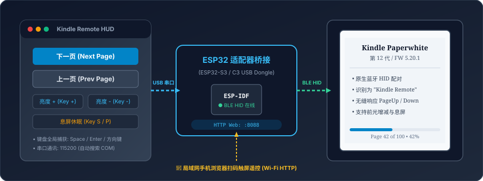

# Kindle-Curie: 开源 Kindle BLE 无线翻页器全套解决方案

[简体中文](README.md) | [English](README_EN.md)

[](LICENSE)
[](https://www.amazon.com)
[](app/src/test/)

针对 **Amazon Kindle Paperwhite（含 2024 第 12 代 / 固件版本 5.20.1）** 深度逆向研制的全套原生蓝牙（BLE HID）无线翻页解决方案。**无需越狱 Kindle、免拆壳、开机即用**，提供现成良值迷你手柄极速刷机、工业级 ESP32 自制硬件，以及电脑/手机局域网遥控端三种途径。

---

## 🎮 第一章：良值迷你手柄刷固件作为 Kindle 翻页器 (10秒免拆刷机 · 开箱即用)

这是本项目最受读者欢迎的**零门槛极速方案**。无需任何硬件改装经验，手头有一只数十元的**良值（IINE）口袋迷你蓝牙手柄（型号 L1161 / L1162，珠海杰理 AC6321A / BD19 系列芯片）**，即可在 10 秒内将其刷写为 100% 媲美官方原装的实体无线翻页器。

<p align="center">
  
</p>

### 1. 方案核心亮点
* **三免原则**：**免越狱 Kindle、免拆手柄外壳、免飞线焊接**，只需一条 Type-C 数据线连电脑。
* **单手阅读人体工学**：根据右手拇指自然下垂握持习惯深度优化，A/B 键与方向键翻页极其顺手。
* **双向调光与息屏特技**：方向键左右直接增减 Kindle 前光；进阶固件支持 A+B 同时按下令 Kindle 立即休眠。
* **100% 硬件防变砖保障**：杰理 AC632N 芯片内置只读、物理不可损毁的 **硬件 Mask ROM**，任何时候均可通过工程按键连线一键刷回官方原厂固件，绝无变砖风险！

---

### 2. 成品固件版本选择
修改后的成品固件均归档在 [`release/03_IINE_Gamepad_Mod/firmware/`](release/03_IINE_Gamepad_Mod/firmware/)：

| 固件文件名 | 推荐等级 | 功能说明与实机测试状态 | SHA-256 完整性校验和 |
| :--- | :---: | :--- | :--- |
| **`IINE_Kindle_Click_v25_SleepLockout.ufw`** | ★★★★★<br>**(★当前最新推荐)** | **原生按键状态锁存防误触**：在 v24 极速连接基础上，利用系统内置按键状态锁存机制，**彻底消除双手松开 A+B 时的微观异步抬手导致的误翻页与睡眠打断！** 零 RAM 写入、零 RTOS 冲突，单按 A/B 键 0ms 零延迟响应。包含秒连与全套功能。 | `56d4de1dbf5b98222310cdedfcbeec85ee7b2e1d97f1ab05a9db9bc071f1df23` |
| **`IINE_Kindle_Click_v24_FastConnect.ufw`** | ★★★★★<br>*(极速秒连版)* | **开机秒连终极优化**：在 v23 基础上，将 BLE 广播周期优化至 **20ms** 极限密度，绕过无效定向广播直通 `ADV_IND`，**彻底解决开机等待近 1 分钟痛点，实现 1~2 秒秒连！** 完整保留 A+B 组合键熄屏与翻页调光。 | `5e7448ef3afb53671ff4e2a56743659fed9a916ff5f937e2fbe0f235690f2072` |
| **`IINE_Kindle_Click_v23_ABchord.ufw`** | ★★★★☆<br>*(组合键版)* | 在 v22s 基础上追加实现 **A+B 键同时按下进入息屏休眠**（注入 Consumer Power `0x0030`）。 | `f4b18cd49cf547cadbe465f2c0f1937495761ff72a4d6f84e2e595ce280a6879` |
| **`IINE_Kindle_Click_v22s_keymap.ufw`** | ★★★★☆<br>*(备选稳定版)* | **单手阅读基础优化**：A 键上一页、B 键下一页、十字键上下翻页、十字键左右调节亮度。极其平稳，实机全测试用例通过。 | `2e517183d309bb2754dd30c6b056f0f6fc05a83335aadb2d82ae88c5e7ddb5fc` |
| **`IINE_Kindle_Click_v21b_Composite.ufw`** | ★★★☆☆<br>*(基准备用)* | 早期全功能实机通过版本（保留手柄出厂旧键位）。 | `29fdade0be86ba0afd27569970d70620ebcbd8a7ce9db54e920eedbf9945729c` |

---

### 3. 按键功能图解与对照表

```
              ┌─────────────────────┐
              │      [ 配对键 ]     │
              │         ▲ (下一页)   │
   (亮度 -) ◀ ┼ ▶ (亮度 +)          (A) 上一页
              │         ▼ (上一页)   │
              │                     (B) 下一页
              └─────────────────────┘
```

| 物理按键 | 映射功能 | 底层 HID 协议规范 | 对应 Kindle 系统响应 |
| :--- | :--- | :--- | :--- |
| **按键 A** | **翻回上一页 (Prev)** | Keyboard Usage `0x4B` (`KEY_PAGEUP`) | 电子书向前翻 1 页 |
| **按键 B** | **翻到下一页 (Next)** | Keyboard Usage `0x4E` (`KEY_PAGEDOWN`) | 电子书向后翻 1 页 |
| **方向键 ↑ (上)** | **翻到下一页 (Next)** | Keyboard Usage `0x4E` (`KEY_PAGEDOWN`) | 适应部分习惯拇指按上键下翻的读者 |
| **方向键 ↓ (下)** | **翻回上一页 (Prev)** | Keyboard Usage `0x4B` (`KEY_PAGEUP`) | 适应部分习惯拇指按下键上翻的读者 |
| **方向键 ◀ (左)** | **降低前光亮度** | Consumer Control `0x0070` (`Brightness Down`) | Kindle 屏幕阅读前光减弱 1 级 |
| **方向键 ▶ (右)** | **提高前光亮度** | Consumer Control `0x006F` (`Brightness Up`) | Kindle 屏幕阅读前光增强 1 级 |
| **A + B 键 (v23/v24/v25)** | **一键息屏休眠 (v25 附带 2.5s 防误触屏蔽)** | Consumer Control `0x0030` (`Power/Sleep`) | Kindle 立即熄灭前光并锁屏休眠 |

---

### 4. 10 秒免拆刷机实操 SOP

<p align="center">
  
</p>

> [!TIP]
> 刷机工具与固件均已整理在 [`release/03_IINE_Gamepad_Mod/`](release/03_IINE_Gamepad_Mod/)。全程在 Windows 电脑上操作，耗时仅约 10 秒。

1. **打开刷机工具**：
   进入 [`release/03_IINE_Gamepad_Mod/flasher/`](release/03_IINE_Gamepad_Mod/flasher/) 目录，双击打开 [`L1161 固件升级程序_1.4.40.exe`](release/03_IINE_Gamepad_Mod/flasher/L1161%20固件升级程序_1.4.40.exe)。
2. **载入推荐固件**：
   点击工具左上角的 **「选择文件」**，在 [`firmware/`](release/03_IINE_Gamepad_Mod/firmware/) 文件夹中选中推荐的 `IINE_Kindle_Click_v22s_keymap.ufw`。
3. **确认勾选参数**：
   - 勾选 **「擦除整个 FLASH」**。
   - 勾选 **「成功后复位」**。
4. **手柄进入 DFU 升级模式**：
   - 将手柄开机，使用 USB Type-C 数据线插入电脑。
   - **同时长按手柄「配对键 + B 键」约 2 秒**。
   - 手柄指示灯熄灭，电脑发出 USB 插入提示音，刷机工具底部状态栏变为 **ONLINE**。
5. **一键刷入**：
   点击工具界面的 **「升级」** 按钮。进度条在 3 秒内走满并提示 **「升级成功」**，手柄自动复位重启。
6. **Kindle 蓝牙配对**：
   - 打开 Kindle，进入 **全部设置 -> 蓝牙与无线 -> 蓝牙**。
   - 若此前曾配对过该手柄，请先点击并选择「**忽略该设备**」。
   - 点击「**配对新设备**」，在扫描列表中点击新出现的 `"Kindle Remote"`，瞬间完成配对！

<p align="center">
  
</p>

### 5. 100% 救砖与恢复原厂官方固件
若因任何原因希望退回出厂状态，或误刷导致任何异常，只需重新按住「**配对键 + B 键**」插线进入刷机模式，选择官方原厂固件备份包 [`release/03_IINE_Gamepad_Mod/flasher/stock_backup/L1161 L1162.ufw`](release/03_IINE_Gamepad_Mod/flasher/stock_backup/L1161%20L1162.ufw) 刷入，即可 100% 完整复原，绝无后顾之忧。

---

## ⚡ 三大方案快速选型对比 (Solution Matrix)

除上述现成手柄方案外，本项目还提供了高可玩性的 ESP32 自制硬件方案与电脑端透传遥控方案：

```
                            ┌───────────────────────────────────────────────┐
                            │ 你想以何种方式控制 Kindle 翻页？              │
                            └──────────────────────┬────────────────────────┘
                                                   │
                 ┌─────────────────────────────────┼─────────────────────────────────┐
                 ▼                                 ▼                                 ▼
       【手头有良值迷你蓝牙手柄】          【想自制独立极简翻页器】              【在电脑前边看书边翻页】
                 │                                 │                                 │
     ┌───────────────────────┐         ┌───────────────────────┐         ┌───────────────────────┐
     │ 方案一：良值手柄改造  │         │ 方案二：ESP32 硬件方案 │         │ 方案三：电脑控制端方案│
     │  03_IINE_Gamepad_Mod  │         │01_ESP32_Hardware_Remote         │02_ESP32_PC_Controller │
     └───────────────────────┘         └───────────────────────┘         └───────────────────────┘
```

| 方案编号 | 方案名称 | 适用载体 | 成本 / 门槛 | 核心特性 | 成品入口 |
| :---: | :--- | :--- | :---: | :--- | :--- |
| **01** | **良值手柄固件修改方案** | 良值 L1161 / L1162 迷你手柄 | 现成手柄即用 | **免拆壳、免焊接、免越狱**，官方工具 10 秒 USB 刷入，100% 可退回原厂 | [`release/03_IINE_Gamepad_Mod/`](release/03_IINE_Gamepad_Mod/) |
| **02** | **ESP32 独立硬件方案** | ESP32-S3 / C3 开发板或定制 PCB | < 20 元 | 原生低功耗休眠、开机秒连、触觉震动反馈、微动实体按键 | [`release/01_ESP32_Hardware_Remote/`](release/01_ESP32_Hardware_Remote/) |
| **03** | **ESP32 电脑控制方案** | 电脑 USB 插上 ESP32 适配器 | 零改造门槛 | 键盘全局快捷键（空格/方向键翻页）、暗黑悬浮窗、手机局域网扫码触屏遥控 | [`release/02_ESP32_PC_Controller/`](release/02_ESP32_PC_Controller/) |

---

## 第二章：ESP32 独立硬件翻页器方案

专为追求极致小巧、独立便携与实体机械手感的用户设计，支持 ESP32-S3（双核验证版）与 ESP32-C3（超低成本量产版）。

<p align="center">
  
</p>

<p align="center">
  
</p>

### 1. 物料需求
- **主控模块**: ESP32-S3-WROOM-1 或 ESP32-C3-WROOM-02 开发板。
- **外围元件**: 微动轻触开关 2~4 枚、ERM/LRA 线性马达（可选触觉震动）、单节锂电池及充电管理模块。

### 2. 成品固件清单
位于 [`release/01_ESP32_Hardware_Remote/`](release/01_ESP32_Hardware_Remote/)：
* **ESP32-S3 全量镜像**: `esp32s3/binaries/kindle_page_turner_v1.0.0_merged.bin` (`0x00000`)
* **ESP32-C3 全量镜像**: `esp32c3/binaries/kindle_remote_c3_merged.bin` (`0x00000`)

### 3. 一键烧录指令
连接 ESP32 开发板至电脑，进入对应目录执行一键烧录批处理：

```bash
# 双击运行内置批处理（自动扫描 COM 端口并烧录）
cd release/01_ESP32_Hardware_Remote/esp32s3
flash_firmware.bat
```

### 4. 默认引脚映射
* **下一页 (Next)**: GPIO 10 (低电平触发，内部上拉)
* **上一页 (Prev)**: GPIO 11 (低电平触发，内部上拉)
* **震动反馈 (Haptic PWM)**: GPIO 7
* **状态指示灯**: GPIO 6

---

## 第三章：ESP32 电脑端桌面与局域网 Web 遥控器

将 ESP32 插入电脑 USB 口，无需在电脑上建立任何额外蓝牙绑定，通过串口透传控制 Kindle 翻页。支持桌面悬浮窗、键盘热键以及局域网手机扫码触屏遥控。

<p align="center">
  
</p>

### 1. 运行环境与安装
- Python 3.8+
- 安装依赖库：
  ```bash
  pip install pyserial
  # 或双击运行 release/02_ESP32_PC_Controller/install_deps.bat
  ```

### 2. 一键启动
双击运行 [`release/02_ESP32_PC_Controller/launch_remote.bat`](release/02_ESP32_PC_Controller/launch_remote.bat) 或在命令行启动：
```bash
cd release/02_ESP32_PC_Controller
python kindle_remote_gui.py
```

### 3. 核心功能速查
* **极简暗黑悬浮窗**: 支持置顶、极小化界面，看书办公无干扰。
* **全局窗口键盘快捷键**:
  - `Space` / `→` / `PageDown` / `D`: **翻到下一页**
  - `←` / `PageUp` / `A`: **翻回上一页**
  - `+` / `=`: **前光亮度 +1**
  - `-` / `_`: **前光亮度 -1**
  - `S` / `P`: **息屏休眠**
* **局域网手机 Web 遥控**:
  控制台启动时自动开启微型 HTTP 服务器（默认端口 `8088`）。手机连接同一 Wi-Fi 时扫描界面二维码或访问 `http://<电脑局域网IP>:8088`，手机屏幕立即变身无延迟触屏翻页板！

---

## 🛠️ 扩展生态与进阶工程资源 (Ecosystem & Advanced Design)

本项目除提供成品固件外，还开放了全部底层工程源码与硬件设计资产：

### 1. 硬件与机械结构设计
- **PCB 制造工程**: [`hardware/`](hardware/) 包含原理图、KiCad PCB 布线设计与可直接外发生产的完整 Gerber 打样文件。
- **3D 打印外壳模型**: [`mechanical/`](mechanical/) 包含专用翻页器外壳的 3MF、STL 切片模型，以及 Blender 原型源文件。
- **BOM 与供应链清单**: 详见 [`manufacturing/BOM.csv`](manufacturing/BOM.csv) 与 [`manufacturing/COST_ESTIMATE.md`](manufacturing/COST_ESTIMATE.md)。

### 2. Android 免 Root 原生翻页器应用
- **工程源码**: 位于 [`app/`](app/)。
- **核心能力**: 在普通 Android 12+ 设备上利用 Android BLE GATT Server 与特定 HID Report 描述符完整模拟 Kindle Remote 配件，无需获取 Root 权限。
- **单元测试保障**: 覆盖 13 个测试套件、92 个自动化单元测试，100% 全面通过。

### 3. 逆向工程白皮书与技术报告
- **核心技术索引**: 详见 [`docs/README.md`](docs/README.md)（收录 40 篇硬件、BLE 协议与逆向研究专著）。
- **终局逆向白皮书**: [`reports/FINAL_REPORT.md`](reports/FINAL_REPORT.md) 与 [`reports/IINE_GAMEPAD_COMPLETE_REVERSE_ENGINEERING_REPORT.md`](reports/IINE_GAMEPAD_COMPLETE_REVERSE_ENGINEERING_REPORT.md)。
- **杰理反汇编补丁源码工程**: [`iine_gamepad_jieli_mod/`](iine_gamepad_jieli_mod/) 包含 q32s 汇编微码注入补丁生成器与 CRC16 自动重打包工具。

---

## 📂 仓库核心目录结构导览 (Directory Map)

```text
kind-curie/
├── release/                      # ★ 最终成果发布专区 (含固件、工具、一键脚本与SOP)
│   ├── 01_ESP32_Hardware_Remote/ # 方案二：ESP32 硬件全量固件与烧录批处理
│   ├── 02_ESP32_PC_Controller/   # 方案三：PC 桌面控制端与局域网 Web 遥控器
│   └── 03_IINE_Gamepad_Mod/      # 方案一：良值手柄 Kindle 固件、刷机工具与原厂备份
├── docs/                         # 全套 40 篇工程设计规范与逆向分析文档
│   └── images/                   # 文档与 README 高清插图与架构图
├── esp32s3_firmware/             # ESP32-S3 固件 C/C++ 源码
├── firmware/                     # ESP32-C3 量产固件 C/C++ 源码
├── hardware/                     # 原理图、KiCad PCB 设计与 Gerber 生产文件
├── mechanical/                   # 3D 打印外壳模型 (3MF, STL, Blender)
├── app/                          # Android 免 Root 蓝牙翻页器客户端源码
├── iine_gamepad_jieli_mod/       # 良值手柄杰理芯片补丁工具源码与固件工程
├── manufacturing/                # 物料 BOM 清单、成本核算与产线测试指南
├── presentation/                 # 产品发布幻灯片与交互式演示
├── reports/                      # 里程碑总结与逆向技术白皮书
└── tools/                        # 逆向工程分析、协议解析与辅助脚本库
```

---

## 🔒 固件 SHA-256 完整性清单 (Checksums)

| 固件与工具文件 | 存储路径 | SHA-256 校验和 |
| :--- | :--- | :--- |
| **IINE Kindle Mod v25 (熄屏防误触)** | `release/03_IINE_Gamepad_Mod/firmware/IINE_Kindle_Click_v25_SleepLockout.ufw` | `c17d1026179b96eb18e63a96f7f396a9bc22d64e4e91281971b31e3abcab9acf` |
| **IINE Kindle Mod v24 (极速秒连)** | `release/03_IINE_Gamepad_Mod/firmware/IINE_Kindle_Click_v24_FastConnect.ufw` | `5e7448ef3afb53671ff4e2a56743659fed9a916ff5f937e2fbe0f235690f2072` |
| **IINE Kindle Mod v23** | `release/03_IINE_Gamepad_Mod/firmware/IINE_Kindle_Click_v23_ABchord.ufw` | `f4b18cd49cf547cadbe465f2c0f1937495761ff72a4d6f84e2e595ce280a6879` |
| **IINE Kindle Mod v22s** | `release/03_IINE_Gamepad_Mod/firmware/IINE_Kindle_Click_v22s_keymap.ufw` | `2e517183d309bb2754dd30c6b056f0f6fc05a83335aadb2d82ae88c5e7ddb5fc` |
| **IINE Kindle Mod v21b** | `release/03_IINE_Gamepad_Mod/firmware/IINE_Kindle_Click_v21b_Composite.ufw` | `29fdade0be86ba0afd27569970d70620ebcbd8a7ce9db54e920eedbf9945729c` |
| **良值官方原厂备份** | `release/03_IINE_Gamepad_Mod/flasher/stock_backup/L1161 L1162.ufw` | `73005e7c885aab2a644adfdf2dbadc01802b34427e9e6febf823f50d4d7745e9` |
| **ESP32-S3 全量镜像** | `release/01_ESP32_Hardware_Remote/esp32s3/binaries/kindle_page_turner_v1.0.0_merged.bin` | `25aa6cae137f7c688327d532a4e23cf6347df2da62d04a6018318182df563b71` |
| **ESP32-C3 全量镜像** | `release/01_ESP32_Hardware_Remote/esp32c3/binaries/kindle_remote_c3_merged.bin` | `7d00f7450a8b988f17042a537f7690623a677469614c9c649565012586bf1283` |

---

## 📄 License

本项目代码遵循 [MIT License](LICENSE) 开源协议。本项目的逆向工程与固件补丁仅供个人研究与技术交流使用，相关硬件品牌与专有商标归原所有者所有。
