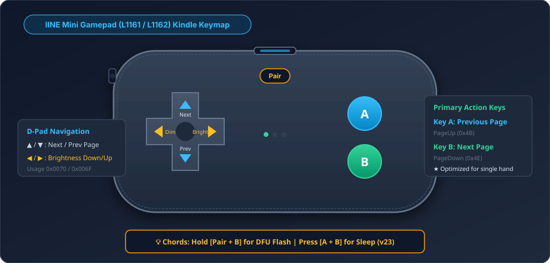
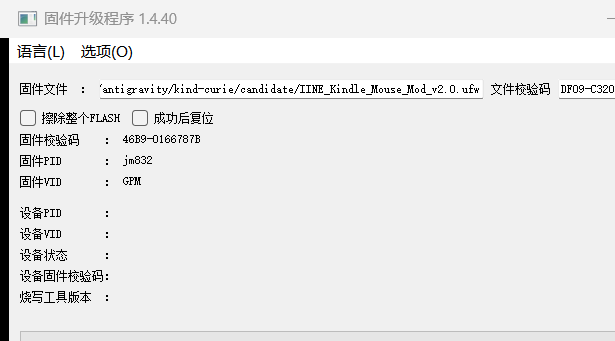
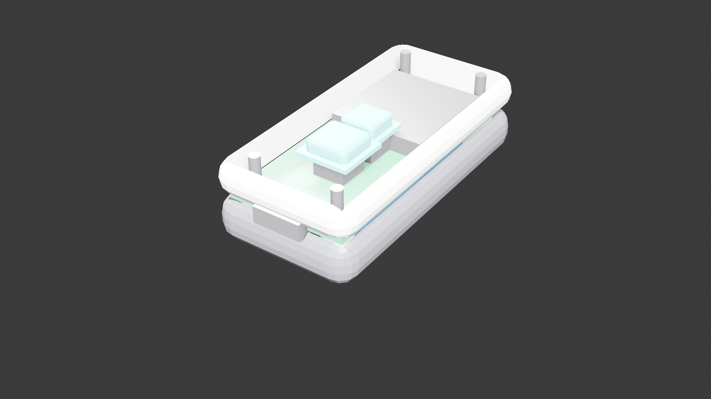
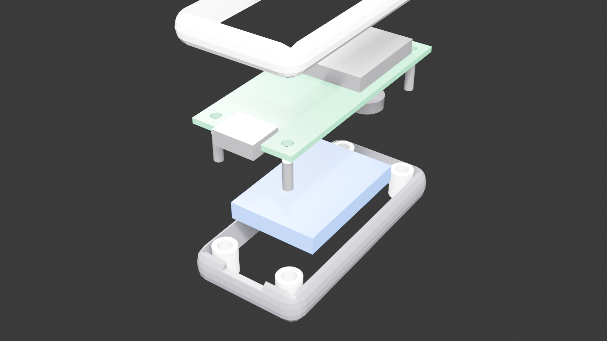
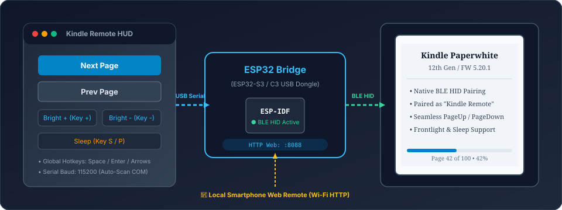

# Kindle-Curie: Open-Source Kindle BLE Wireless Page Turner Suite

[简体中文](README.md) | [English](README_EN.md)

[](LICENSE)
[](https://www.amazon.com)
[](app/src/test/)

A complete, production-grade Bluetooth Low Energy (BLE HID) wireless page-turner suite reverse-engineered for **Amazon Kindle Paperwhite (including 2024 12th Gen / Firmware 5.20.1)**. **No Kindle jailbreak required, no case opening needed, instant out-of-the-box operation.** Offers three distinct solutions: commercial IINE gamepad 10-second DFU modding, DIY dedicated ESP32 hardware, and PC/mobile remote controllers.

---

## 🎮 Chapter 1: IINE Mini Gamepad Firmware Modding as Kindle Remote (10-Second No-Disassembly Flash)

This is the most popular, **zero-barrier ready-to-use solution** in this project. With an inexpensive **IINE Pocket Mini Bluetooth Gamepad (Models L1161 / L1162, powered by Zhuhai JieLi AC6321A / BD19 SoC)**, you can transform it in under 10 seconds into a dedicated physical wireless page-turner that matches the official accessories.

<p align="center">
  
</p>

### 1. Key Highlights
* **Zero Disassembly / Zero Soldering**: **No Kindle jailbreak, no shell opening, no soldering required**; flash purely via a standard USB Type-C cable.
* **Ergonomic Single-Hand Reading**: Natural thumb resting positions mapped to Button A (Previous) and Button B (Next).
* **Dual-Direction Dimming & Sleep Chord**: D-Pad horizontal keys adjust Kindle frontlight brightness; press A+B simultaneously to instantly put Kindle to sleep.
* **100% Hardware Mask ROM Unbricking Guarantee**: The JieLi AC632N SoC contains an unmodifiable, physical **Hardware Mask ROM**. You can always enter DFU mode to restore 100% factory firmware with zero bricking risk.

---

### 2. Firmware Releases
All modified binary releases are archived in [`release/03_IINE_Gamepad_Mod/firmware/`](release/03_IINE_Gamepad_Mod/firmware/):

| Firmware | Recommended | Description & Hardware Verification | SHA-256 Checksum |
| :--- | :---: | :--- | :--- |
| **`IINE_Kindle_Click_v22s_keymap.ufw`** | ★★★★★<br>**(Recommended Stable)** | **Ultimate One-Hand Layout**: Button A = Prev, Button B = Next, D-Pad Up/Down = Next/Prev, D-Pad Left/Right = Brightness Down/Up. Rock-solid stability; 100% verified on real hardware. | `2e517183d309bb2754dd30c6b056f0f6fc05a83335aadb2d82ae88c5e7ddb5fc` |
| **`IINE_Kindle_Click_v23_ABchord.ufw`** | ★★★★☆<br>*(Chord Power Edition)* | Based on v22s, adds **A+B simultaneous chord press to put Kindle to sleep** (injects Consumer Power `0x0030`). | `f4b18cd49cf547cadbe465f2c0f1937495761ff72a4d6f84e2e595ce280a6879` |
| **`IINE_Kindle_Click_v21b_Composite.ufw`** | ★★★☆☆<br>*(Legacy Baseline)* | Early full-feature verified build retaining factory gamepad keymap. | `29fdade0be86ba0afd27569970d70620ebcbd8a7ce9db54e920eedbf9945729c` |

---

### 3. Keymap Diagram & Protocol Reference

```
              ┌─────────────────────┐
              │     [ Pair Key ]    │
              │         ▲ (Next)    │
  (Bright -) ◀ ┼ ▶ (Bright +)       (A) Prev Page
              │         ▼ (Prev)    │
              │                     (B) Next Page
              └─────────────────────┘
```

| Physical Button | Mapped Function | HID Protocol Specification | Kindle System Response |
| :--- | :--- | :--- | :--- |
| **Button A** | **Previous Page (Prev)** | Keyboard Usage `0x4B` (`KEY_PAGEUP`) | Turns page backward |
| **Button B** | **Next Page (Next)** | Keyboard Usage `0x4E` (`KEY_PAGEDOWN`) | Turns page forward |
| **D-Pad ▲ (Up)** | **Next Page (Next)** | Keyboard Usage `0x4E` (`KEY_PAGEDOWN`) | Alternative thumb downward page turn |
| **D-Pad ▼ (Down)** | **Previous Page (Prev)** | Keyboard Usage `0x4B` (`KEY_PAGEUP`) | Alternative thumb upward page turn |
| **D-Pad ◀ (Left)** | **Brightness Down** | Consumer Control `0x0070` (`Brightness Down`) | Decreases Kindle frontlight by 1 level |
| **D-Pad ▶ (Right)** | **Brightness Up** | Consumer Control `0x006F` (`Brightness Up`) | Increases Kindle frontlight by 1 level |
| **A + B Buttons (v23)** | **Sleep / Screen Off** | Consumer Control `0x0030` (`Power/Sleep`) | Puts Kindle display to sleep |

---

### 4. 10-Second Flashing SOP (No Shell Opening, No Soldering)

<p align="center">
  
</p>

> [!TIP]
> Both flasher and firmware are pre-packaged in [`release/03_IINE_Gamepad_Mod/`](release/03_IINE_Gamepad_Mod/). Flashing takes only ~10 seconds on any Windows 10/11 PC.

1. **Launch Flasher Utility**:
   Navigate to [`release/03_IINE_Gamepad_Mod/flasher/`](release/03_IINE_Gamepad_Mod/flasher/) and run [`L1161 固件升级程序_1.4.40.exe`](release/03_IINE_Gamepad_Mod/flasher/L1161%20固件升级程序_1.4.40.exe).
2. **Select Firmware**:
   Click "Select File" on the top left and choose `IINE_Kindle_Click_v22s_keymap.ufw` in [`firmware/`](release/03_IINE_Gamepad_Mod/firmware/).
3. **Configure Options**:
   - Check **"Erase entire FLASH"** (擦除整个FLASH).
   - Check **"Reset after success"** (成功后复位).
4. **Enter DFU Mode on Gamepad**:
   - Power on the gamepad and connect it to PC via a USB Type-C data cable.
   - **Press and hold "Pair Button + Button B" for ~2 seconds**.
   - Gamepad LED turns off, PC plays USB connection chime, and tool status bar displays **ONLINE**.
5. **One-Click Flash**:
   Click **"Upgrade"** (升级). Progress bar fills in under 3 seconds, reports "Upgrade Success", and the gamepad reboots automatically.
6. **Pair with Kindle**:
   - On your Kindle, go to **All Settings -> Bluetooth & Wireless -> Bluetooth**.
   - If previously paired, select the old entry and choose "**Forget Device**".
   - Tap **Pair New Device**, select `"Kindle Remote"` from the scan list, and enjoy wireless reading!

<p align="center">
  
</p>

### 5. 100% Factory Restore & Unbricking
If you ever want to revert to factory state, simply hold "Pair + B", plug in the USB cable to enter DFU mode, and flash the factory stock backup [`release/03_IINE_Gamepad_Mod/flasher/stock_backup/L1161 L1162.ufw`](release/03_IINE_Gamepad_Mod/flasher/stock_backup/L1161%20L1162.ufw).

---

## ⚡ Solution Decision Matrix

In addition to the gamepad modding solution above, this suite provides dedicated DIY hardware and PC/phone remote control solutions:

```
                            ┌───────────────────────────────────────────────┐
                            │ How do you want to control your Kindle?       │
                            └──────────────────────┬────────────────────────┘
                                                   │
                 ┌─────────────────────────────────┼─────────────────────────────────┐
                 ▼                                 ▼                                 ▼
        【Own an IINE Mini Gamepad】       【Build DIY Dedicated HW】         【Read at Desk on PC】
                 │                                 │                                 │
     ┌───────────────────────┐         ┌───────────────────────┐         ┌───────────────────────┐
     │ Solution 1: IINE Mod  │         │ Solution 2: ESP32 HW  │         │ Solution 3: PC Remote │
     │  03_IINE_Gamepad_Mod  │         │01_ESP32_Hardware_Remote         │02_ESP32_PC_Controller │
     └───────────────────────┘         └───────────────────────┘         └───────────────────────┘
```

| # | Solution | Target Hardware | Cost / Skill | Key Highlights | Release Directory |
| :---: | :--- | :--- | :---: | :--- | :--- |
| **01** | **IINE Gamepad Firmware Mod** | IINE L1161 / L1162 Mini Bluetooth Gamepad | Existing commercial gamepad | **No disassembly, no soldering, no jailbreak**; 10-second USB DFU flash, 100% reversible to factory stock | [`release/03_IINE_Gamepad_Mod/`](release/03_IINE_Gamepad_Mod/) |
| **02** | **ESP32 Dedicated Hardware** | ESP32-S3 / ESP32-C3 Dev Board or Custom PCB | < $3 | Native ultra-low power sleep, instant reconnection, haptic feedback, tactile switches | [`release/01_ESP32_Hardware_Remote/`](release/01_ESP32_Hardware_Remote/) |
| **03** | **ESP32 PC & Web Controller** | Windows PC + ESP32 USB dongle | Zero build barrier | Global keyboard shortcuts (Space/Arrow keys), dark floating window, mobile local Web remote | [`release/02_ESP32_PC_Controller/`](release/02_ESP32_PC_Controller/) |

---

## Chapter 2: ESP32 Dedicated Hardware Remote

Engineered for users who demand ultra-compact dimensions, dedicated portability, and crisp tactile mechanical feel. Supports ESP32-S3 (dual-core validated version) and ESP32-C3 (ultra-low-cost mass-production version).

<p align="center">
  
</p>

<p align="center">
  
</p>

### 1. Bill of Materials (BOM)
- **MCU Module**: ESP32-S3-WROOM-1 or ESP32-C3-WROOM-02 module/board.
- **Peripherals**: 2–4 tactile switches, ERM/LRA vibration motor (optional haptic feedback), 1S Li-Po battery + TP4056/charging circuitry.

### 2. Ready-to-Flash Firmware Images
Located in [`release/01_ESP32_Hardware_Remote/`](release/01_ESP32_Hardware_Remote/):
* **ESP32-S3 Merged Binary**: `esp32s3/binaries/kindle_page_turner_v1.0.0_merged.bin` (`0x00000`)
* **ESP32-C3 Merged Binary**: `esp32c3/binaries/kindle_remote_c3_merged.bin` (`0x00000`)

### 3. One-Click Flashing Commands
Plug your ESP32 board into your PC via USB, navigate to the target directory, and run the batch script:

```bash
# Double-click or run the built-in batch script (auto-detects COM port)
cd release/01_ESP32_Hardware_Remote/esp32s3
flash_firmware.bat
```

### 4. Default GPIO Pinout
* **Next Page**: GPIO 10 (Active Low, internal pull-up enabled)
* **Previous Page**: GPIO 11 (Active Low, internal pull-up enabled)
* **Haptic Vibration (PWM)**: GPIO 7
* **Status LED**: GPIO 6

---

## Chapter 3: ESP32 PC Desktop & LAN Web Remote Controller

Plug an ESP32 into any PC USB port. With zero Bluetooth pairing required on your computer, the ESP32 acts as a transparent serial-to-BLE bridge to control your Kindle. Features a sleek floating desktop HUD, global keyboard hotkeys, and a local Web remote for smartphones.

<p align="center">
  
</p>

### 1. Prerequisites & Setup
- Python 3.8+
- Install dependencies:
  ```bash
  pip install pyserial
  # Or double-click release/02_ESP32_PC_Controller/install_deps.bat
  ```

### 2. Quick Launch
Double-click [`release/02_ESP32_PC_Controller/launch_remote.bat`](release/02_ESP32_PC_Controller/launch_remote.bat) or start via CLI:
```bash
cd release/02_ESP32_PC_Controller
python kindle_remote_gui.py
```

### 3. Feature & Keymap Reference
* **Dark Mode Floating HUD**: Always-on-top, minimal footprint, unobtrusive during reading or desk work.
* **Global Window Keyboard Shortcuts**:
  - `Space` / `→` / `PageDown` / `D`: **Next Page**
  - `←` / `PageUp` / `A`: **Previous Page**
  - `+` / `=`: **Brightness Up (+1)**
  - `-` / `_`: **Brightness Down (-1)**
  - `S` / `P`: **Sleep / Screen Off**
* **Local LAN Smartphone Web Remote**:
  Launches an embedded micro-HTTP server (default port `8088`). Point your phone's browser (on the same Wi-Fi) to `http://<PC_LOCAL_IP>:8088` or scan the onscreen QR code for an ultra-responsive, zero-latency touch remote!

---

## 🛠️ Extended Ecosystem & Advanced Engineering Assets

Beyond ready-to-use binaries, this repository is completely open-sourced with full engineering source files and research artifacts:

### 1. Hardware & Mechanical CAD
- **PCB Manufacturing**: [`hardware/`](hardware/) contains schematics, KiCad PCB layout, and production-ready Gerber files.
- **3D Printable Enclosures**: [`mechanical/`](mechanical/) contains 3MF and STL slicer models, alongside Blender source prototypes.
- **BOM & Supply Chain**: See [`manufacturing/BOM.csv`](manufacturing/BOM.csv) and [`manufacturing/COST_ESTIMATE.md`](manufacturing/COST_ESTIMATE.md).

### 2. Android No-Root Virtual Remote App
- **Source Code**: Located in [`app/`](app/).
- **Architecture**: Emulates a native Kindle Remote on standard Android 12+ devices using Android BLE GATT Server and custom HID report descriptors without requiring root access.
- **Automated Tests**: 13 test suites with 92 unit tests passed (100% pass rate).

### 3. Reverse Engineering Whitepapers & Specifications
- **Master Doc Index**: Detailed in [`docs/README.md`](docs/README.md) (catalog of 40 hardware, BLE, and reverse-engineering specs).
- **Core Whitepapers**: [`reports/FINAL_REPORT.md`](reports/FINAL_REPORT.md) and [`reports/IINE_GAMEPAD_COMPLETE_REVERSE_ENGINEERING_REPORT.md`](reports/IINE_GAMEPAD_COMPLETE_REVERSE_ENGINEERING_REPORT.md).
- **JieLi Patch Pipeline**: [`iine_gamepad_jieli_mod/`](iine_gamepad_jieli_mod/) includes q32s assembly microcode patcher and cascaded CRC16 repack scripts.

---

## 📂 Repository Directory Map

```text
kind-curie/
├── release/                      # ★ Final deliverables (Firmware, GUI tools, one-click scripts, SOPs)
│   ├── 01_ESP32_Hardware_Remote/ # Solution 2: Merged binaries & flashing scripts
│   ├── 02_ESP32_PC_Controller/   # Solution 3: PC desktop HUD & LAN Web remote
│   └── 03_IINE_Gamepad_Mod/      # Solution 1: Modified UFWs, DFU flasher & factory backup
├── docs/                         # Comprehensive engineering specs & reverse-engineering catalog (40 docs)
│   └── images/                   # High-resolution CAD renders & architecture diagrams for README
├── esp32s3_firmware/             # ESP32-S3 firmware C/C++ source code
├── firmware/                     # ESP32-C3 firmware C/C++ source code
├── hardware/                     # Schematics, KiCad PCB layout & Gerber production archives
├── mechanical/                   # 3D printable CAD models (3MF, STL, Blender)
├── app/                          # Android no-root virtual page-turner client source code
├── iine_gamepad_jieli_mod/       # IINE gamepad patch generation toolchain & firmware source
├── manufacturing/                # Component BOM, cost estimates & production testing guide
├── presentation/                 # Product design pitch deck & interactive HTML slides
├── reports/                      # Milestone reports & reverse-engineering whitepapers
└── tools/                        # Protocol analysis, decompilation & helper script suite
```

---

## 🔒 Firmware Integrity Ledger (SHA-256)

| Release Artifact | Path | SHA-256 Checksum |
| :--- | :--- | :--- |
| **IINE Kindle Mod v22s** | `release/03_IINE_Gamepad_Mod/firmware/IINE_Kindle_Click_v22s_keymap.ufw` | `2e517183d309bb2754dd30c6b056f0f6fc05a83335aadb2d82ae88c5e7ddb5fc` |
| **IINE Kindle Mod v23** | `release/03_IINE_Gamepad_Mod/firmware/IINE_Kindle_Click_v23_ABchord.ufw` | `f4b18cd49cf547cadbe465f2c0f1937495761ff72a4d6f84e2e595ce280a6879` |
| **IINE Kindle Mod v21b** | `release/03_IINE_Gamepad_Mod/firmware/IINE_Kindle_Click_v21b_Composite.ufw` | `29fdade0be86ba0afd27569970d70620ebcbd8a7ce9db54e920eedbf9945729c` |
| **IINE Factory Stock Backup** | `release/03_IINE_Gamepad_Mod/flasher/stock_backup/L1161 L1162.ufw` | `73005e7c885aab2a644adfdf2dbadc01802b34427e9e6febf823f50d4d7745e9` |
| **ESP32-S3 Merged Binary** | `release/01_ESP32_Hardware_Remote/esp32s3/binaries/kindle_page_turner_v1.0.0_merged.bin` | `25aa6cae137f7c688327d532a4e23cf6347df2da62d04a6018318182df563b71` |
| **ESP32-C3 Merged Binary** | `release/01_ESP32_Hardware_Remote/esp32c3/binaries/kindle_remote_c3_merged.bin` | `7d00f7450a8b988f17042a537f7690623a677469614c9c649565012586bf1283` |

---

## 📄 License

This repository is distributed under the [MIT License](LICENSE). All reverse-engineering findings and firmware microcode patches are provided strictly for educational and personal research purposes. All trademarks and brand names remain the property of their respective owners.
