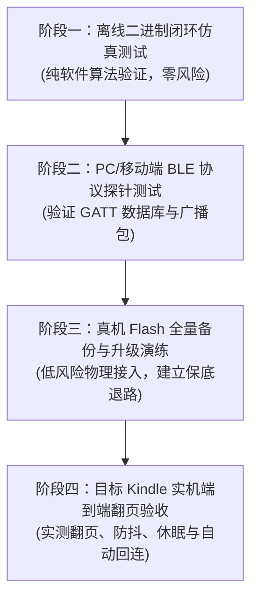

# 修改版固件实验验证与防变砖安全规程 (Experiment & Recovery Plan)

**文档编号**: EVID-EXP-IINE-001  
**适用对象**: 良值迷你手柄 (AC632N) 候选修改固件及物理验证测试  
**生效日期**: 2026-10-14  
**执行原则**: **离线自动化测试优先，无物理回滚方案严禁烧录真机**

---

## 1. 四阶段递进式实验方案 (Four-Stage Verification Protocol)



---

## 2. 阶段一：离线自动化重打包与 CRC 校验测试 (Offline Roundtrip Test)

在不接触任何实体手柄的前提下，验证整个解密、打补丁、再加密、重打包流程的数学正确性：

1. **测试脚本**: 编写自动化测试脚本 [`scripts/test_repack_fix.py`](../../scripts/test_repack_fix.py)。
2. **测试步骤**:
   - 读取已解密的 `app.bin` 并实施候选补丁（改写 PnP ID 为 `0x0171:0x0443`，改写厂商名为 `"Amazon"`）。
   - 调用 `jl_sfc_cipher` 与密钥 `0x190D` 对修改后的 `app.bin` 执行对称流重加密。
   - 组装新的 `flash.bin`，自底向上重新计算 JLFS Entry CRC、Top JLFS CRC 以及 Flash Header CRC。
   - 组装 UFW 容器头部，重新计算 `hdrcrc`、`listcrc` 与 `edcrc`，生成候选固件 `candidate/IINE_Kindle_Mod.ufw`。
   - 使用官方解析器 `fwunpack_newfw.py` 重新读取该候选固件。
3. **通过判定标准 (Success Criteria)**:
   - 官方解包脚本能够 100% 成功解析该固件，**0 项 CRC 不匹配警告，0 项异常抛出**，且解密出的 `app.bin` 包含预期的修改字节。

---

## 3. 阶段三：真机安全烧录与全量备份 SOP (Hardware Safety & Recovery)

> [!CAUTION]
> **绝对禁令**:
> 严禁直接使用官方升级程序刷写未经验证的固件！在烧录前必须通过底层协议导出芯片出厂时的原版 Flash 物理镜像。

### 3.1 实体手柄全量备份操作规程
1. 手柄通过 USB 数据线连接 PC。
2. 按住 **配对键 + B** 保持 2 秒，指示灯灭，芯片进入 USB Bootloader (Mask ROM) 模式。
3. 运行开源工具 `jluboottool` 读取芯片 Flash 前 512 KB 内容：
   ```powershell
   python scripts/jieli_tools/jluboottool.py dump-flash --size 0x80000 --out raw_pkg/factory_physical_dump.bin
   ```
4. 计算 `factory_physical_dump.bin` 的 SHA-256 并归档。此文件为**绝对无法变砖的硬件复原底牌**。

### 3.2 变砖紧急恢复应急预案 (Emergency Recovery)
- 若刷入候选固件后手柄无法开机、按键无响应或无法蓝牙广播：
  - **恢复原理**: 杰理 AC632N 芯片内部包含只读的 **Mask ROM Bootloader**，其升级引导代码是物理烧死在芯片晶圆上的，**任何软件刷写都不会破坏 Mask ROM**。
  - **救砖步骤**:
    1. 拔掉 USB，按住配对键插上 USB（或短接主板上的 Boot 引脚与地）。
    2. 芯片将被强制拉入 Mask ROM 升级模式。
    3. 打开官方升级工具，加载官方原厂固件 `L1161 L1162 IINE-reader.ufw`，勾选“擦除整个 FLASH”，点击“升级”，即可 100% 满血复活。

---

## 4. 阶段四：Kindle 实机端到端验收用例大纲 (Kindle Acceptance Test)

| 用例编号 | 测试目标与动作 | 预期行为与判定指标 | 失败判据与排查方向 |
|:---|:---|:---|:---|
| **TC-01** | **Kindle 蓝牙扫描发现**<br>手柄开机进入翻页模式，Kindle 打开蓝牙搜索 | Kindle 设置界面在 3 秒内搜出设备，显示名称为 `"Kindle Remote"` | 若搜不到：检查广播包中是否正确注入 Amazon 厂商数据 `05 FF 71 01 04 43` |
| **TC-02** | **白名单配对鉴权**<br>在 Kindle 上点击该设备执行配对 | 无需输入配对码，直接配对成功，Kindle 状态栏出现翻页器图标 | 若配对后无响应：检查 PnP ID (`0x2A50`) 是否准确返回 `0x0171:0x0443` |
| **TC-03** | **向前翻下一页**<br>打开一本电子书，按手柄右/下方向键 | Kindle 屏幕立即向前刷新翻至下一页 | 若无反应：检查按键是否发射了键盘 `0x4E`，检查 Report ID 是否为 1 |
| **TC-04** | **向后翻上一页**<br>按手柄左/上方向键 | Kindle 屏幕立即向后刷新翻至上一页 | 若无反应：检查按键是否发射了键盘 `0x4B` |
| **TC-05** | **长按防重复抖动**<br>持续按住翻页键 1 秒 | 仅触发 1 次翻页，松开前不发生连续狂翻 | 检查防抖与 40ms 脉冲释放逻辑 |
| **TC-06** | **熄屏与断连重连**<br>合上磁吸皮套或轻按 Kindle 电源键熄屏，10 秒后唤醒 | Kindle 唤醒点亮后，手柄在 1 秒内自动完成静默重连，无需再次配对 | 检查 NVS/VM 分区中的 LTK 绑定密钥是否保持有效 |
