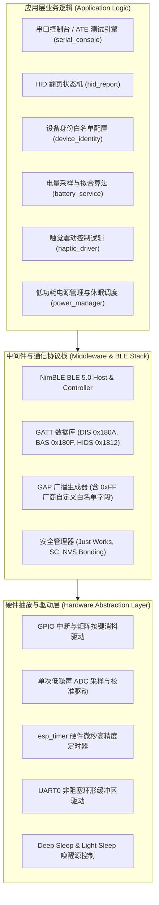
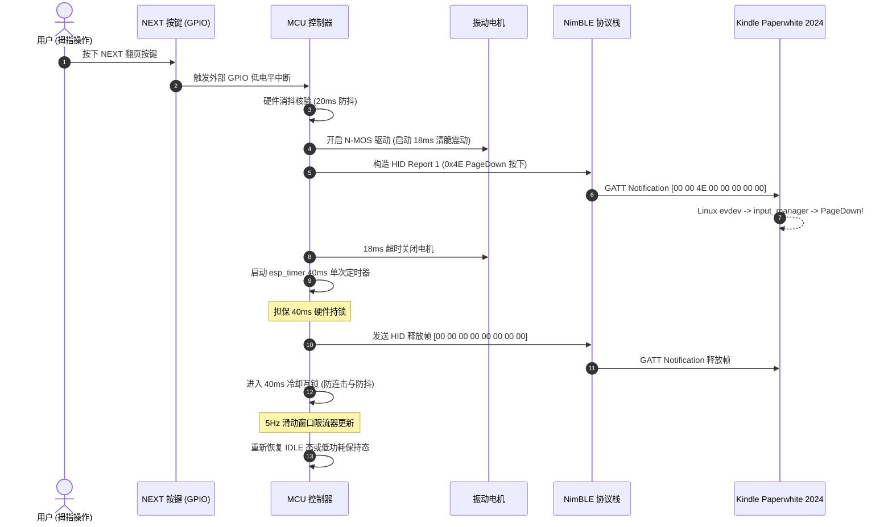

# 系统架构与硬件软件拓扑规范 (System Architecture)

**文档编号**: ENG-ARCH-001  
**版本**: v1.0.0  
**编制日期**: 2026-10-14  

---

## 1. 硬件系统架构 (Hardware System Block Diagram)

```mermaid
flowchart TD
    subgraph PowerSystem ["电源管理系统 (Power & Battery Domain)"]
        USB["USB Type-C 母座 (5V VBUS / CC1, CC2)"] -->|5V 输入| FUSE["自恢复保险丝 (PTC 500mA) + TVS"]
        FUSE -->|VBUS_PROT| CHG["锂电充电管理 IC (TP4057 SOT-23-6)"]
        CHG -->|STAT 指示| LED_CHG["双色指示灯 (红/绿)"]
        CHG <-->|4.2V 恒流恒压| BATT["锂电池 (3.7V 200mAh 402030 带 PCM 保护)"]
        BATT -->|VBAT| LDO["超低静态电流稳压器 (ME6211/XC6206 3.3V)"]
        LDO -->|3.3V System VCC| MCU["主控单元 MCU"]
        BATT -->|VBAT_SENSE (分压)| ADC_SW["P-MOS 电压采样使能开关"]
        ADC_SW -->|V_DIV| MCU_ADC["MCU ADC 输入引脚"]
    end

    subgraph CoreMCU ["主控计算与射频单元 (Core Controller)"]
        MCU -->|2.4GHz 射频匹配| ANT["板载 PCB / 陶瓷天线 (MIFA)"]
        MCU -->|内置晶振/Flash| CLK["40MHz 外部高精度晶振"]
    end

    subgraph HMI ["人机交互系统 (Human-Machine Interface)"]
        BTN_NEXT["主翻页按键 NEXT (微动开关 SMT)"] -->|GPIO / 外部中断| MCU
        BTN_PREV["副翻页按键 PREV (微动开关 SMT)"] -->|GPIO / 外部中断| MCU
        BTN_PWR["电源/配对按键 PWR (微动开关 SMT)"] -->|GPIO / 外部唤醒| MCU
        MCU -->|GPIO / PWM| LED_BLE["BLE 状态指示灯 (蓝/绿)"]
        MCU -->|GPIO 脉冲控制| MOS_DRV["N-MOS 驱动管 (AO3400/2N7002)"]
        MOS_DRV -->|18ms 震动脉冲| MOTOR["0827 微型扁平转子电机 + 续流二极管"]
    end

    subgraph Interfaces ["生产烧录与外部接口 (Test & Flash Interface)"]
        TP["生产测试夹具顶针测试点 (VBUS, GND, 3V3, TX, RX, IO0, EN)"] <--> MCU
        USB -->|D+ / D-| MCU_USB["原生 USB D+/D- 或测试点"]
    end
```

---

## 2. 软件与固件栈架构 (Firmware Stack Architecture)



---

## 3. 电源拓扑与电流预算 (Power Tree & Current Budget)

### 3.1 电源轨规划
| 电源轨 | 标称电压 | 来源 | 最大负载能力 | 供电设备 |
|:---|:---|:---|:---|:---|
| **VBUS** | 5.0V (4.5~5.5V) | USB Type-C 接口 | 500 mA (受保险丝限制) | 充电管理 IC (TP4057) |
| **VBAT** | 3.7V (3.0~4.2V) | 聚合物锂电池 | 200 mA (持续放电) | 稳压器 LDO、震动电机回路、采样分压 |
| **VCC_3V3** | 3.3V ($\pm 2\%$) | 低压差稳压器 (LDO) | 250 mA (峰值) | MCU 核心、射频前端、状态指示 LED |

### 3.2 典型工作场景电流预算 (Current Budget Table)

| 工作场景 | 持续时长 / 频次 | 典型工作电流 | 等效平均功耗贡献 |
|:---|:---|:---|:---|
| **深度休眠 (Deep Sleep)** | 98.5% 时间 | **$12\ \mu\text{A}$** | $11.8\ \mu\text{A}$ |
| **按键唤醒与瞬态广播** | 100 ms (重连阶段) | $16\text{ mA}$ | $0.05\text{ mA}$ |
| **BLE 连接保持态 (Idle)** | 保持连接无按键 | $1.2\text{ mA}$ | $0.15\text{ mA}$ (按每日阅读 2 小时折算) |
| **翻页射频发射 (TX Burst)** | 15 ms (每次按键) | $22\text{ mA}$ | $0.03\text{ mA}$ |
| **震动触觉脉冲 (Haptic)** | 18 ms (每次按键) | $45\text{ mA}$ (电机) | $0.04\text{ mA}$ |
| **综合日平均放电电流** | 综合 24 小时阅读与待机 | **约 $0.18\text{ mA}$** | **续航 $\approx 200\text{mAh} / 0.18\text{mA} \approx 1110\text{ 小时} \approx 46\text{ 天}$** |

---

## 4. 关键接口与时序协作 (Interaction Timing Sequence)


