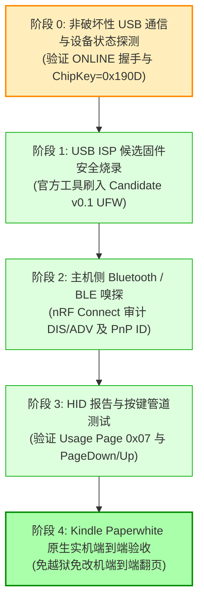

# 良值手柄固件实机验证与安全防砖测试方案 (Test & Recovery SOP)

---

## 一、硬件前置准备与安全底线 (Mandatory Safety Preconditions)

> [!CAUTION]
> **绝对红线 (Stop Conditions)**:
> 1. 在完全掌握恢复机制之前，严禁随意向未知硬件刷入未经 CRC 校验的固件。
> 2. 严禁改动主控内部 OTP / eFuse 寄存器（升级程序已固化只读保护）。
> 3. 必须在确保 USB 供电稳定、数据线接触良好的前提下进行固件刷写。

### 1.1 恢复兜底机制核定 (Recovery Assurance)
根据第 3 阶段深度逆向确认的事实：
- **方案 A（首选免拆机恢复）**：官方升级工具 (`L1161 固件升级程序_1.4.40.exe`) + 原厂固件 (`L1161 L1162 IINE-reader.ufw`)。
  - UFW 包内含有自地址 `0x000000` 开始的完整 Flash 系统（包含 `uboot.boot`）。
  - 若候选固件运行异常，长按 `配对 + B` 键 2 秒即可重新上线，刷入原厂 UFW 即可 100% 恢复。
- **方案 B（终极硬件短接救砖）**：
  - 杰理 AC632N 芯片内置不可抹除的硬件 Mask ROM。
  - 即使 Bootloader 完全死锁，在开机插入 USB 瞬间短接板载 Flash PIN 1 (CS) / PIN 2 (DO) 至 GND 0.5 秒，即可强制唤醒芯片内置 Mask ROM USB 升级模式，由官方升级工具直接全盘重刷。

---

## 二、全流程安全验证执行规范

### 阶段 0：非破坏性 USB 通信探测 (0 风险)
1. 启动 `extracted/L1161兼容阅星瞳/L1161 固件升级程序_1.4.40.exe`。
2. 手柄正常开机并连接 USB-C 数据线。
3. 手柄按住 `配对键 + B 键` 约 2 秒，观察手柄指示灯熄灭。
4. 观察升级程序状态栏：
   - 确认状态栏变绿并显示 `ONLINE`。
   - 确认识别到设备，且未报错 `Chip key mismatch`。
5. **不点击“升级”按钮**，直接拔出 USB 线或关闭软件，手柄重新开机，验证其可正常开机退出，证明探测过程对设备无任何修改。

### 阶段 1：USB ISP 候选固件烧录
1. 打开官方升级工具，点击浏览，选择生成的候选修改固件：
   `candidate/IINE_Kindle_Mod_Candidate_v0.1.ufw`。
2. 按照官方升级规范，**勾选“擦除整个 FLASH”和“成功后复位”**。
   *(逆向已证实：勾选此项将确保旧 VM 缓存被清空，同时 UFW 内置的 Flash Header、uboot.boot 及新 app.bin 会被完整重写)*。
3. 手柄按住 `配对 + B` 键 2 秒，待状态栏显示 `ONLINE`。
4. 点击 `升级` 按钮，观察烧录进度条从 0% 行进至 100%，耗时约 8-12 秒。
5. 提示 `升级成功`，手柄自动复位重启。

### 阶段 2：主机侧 Bluetooth / BLE 协议嗅探
1. 使用智能手机打开 **nRF Connect for Mobile**。
2. 手柄按住 `配对键 + 方向键上` 开机进入阅读器模式广播。
3. 搜索蓝牙设备：
   - 验证广播名称是否成功体现 Kindle 适配特征或修改后的身份。
   - 验证广播包中的 Appearance 是否为标准 HID Keyboard。
4. 连接手柄并读取 Device Information Service (DIS, UUID `0x180A`):
   - 读取 Manufacturer Name String (`0x2A29`)。
   - 读取 PnP ID (`0x2A50`)：验证 Vendor ID 与 Product ID。
   - 读取 Battery Service (`0x180F`)：验证电池电量服务正常。

### 阶段 3：HID 按键映射与功能验收
1. 将手柄与 Windows PC / Mac 蓝牙配对连接。
2. 运行按键测试工具（如网页版 Keyboard Event Viewer 或 Windows HID 捕获器）。
3. 依次按下方向键上、下、左、右及 A、B 键：
   - 验证方向键是否发送键盘 `Page Up` (Usage `0x4B`) 与 `Page Down` (Usage `0x4E`)，或对应回车/空格键。
   - 确认无连键、死键或按键乱码。

### 阶段 4：Kindle Paperwhite 原生实机最终验收
1. 打开 Kindle Paperwhite，进入 `设置 -> 蓝牙与无线 -> 蓝牙 -> 配对设备`。
2. 手柄按住 `配对键 + 方向键上` 进入配对广播。
3. Kindle 屏幕刷新出对应蓝牙设备，点击连接并确认配对成功。
4. 打开 Kindle 原生图书（AZW3 / KFX / MOBI / TXT）：
   - 单击手柄前进翻页键，墨水屏顺畅向下翻页。
   - 单击手柄后退翻页键，墨水屏顺畅向上翻页。
   - 连续翻页 20 页以上，测试连接稳定性与响应延时。

---

## 三、应急回滚 SOP (一键退回原厂固件)

若候选固件在测试中出现任何未知逻辑异常，按以下步骤即刻回滚：
1. 打开升级工具，选择原厂升级包 `extracted/L1161兼容阅星瞳/L1161 L1162 IINE-reader.ufw`。
2. 勾选 `擦除整个 FLASH` 与 `成功后复位`。
3. 手柄长按 `配对 + B` 2 秒插线联机，显示 `ONLINE`。
4. 点击 `升级`，等待烧录完成。
5. 手柄即刻恢复为出厂 100% 原始状态。
