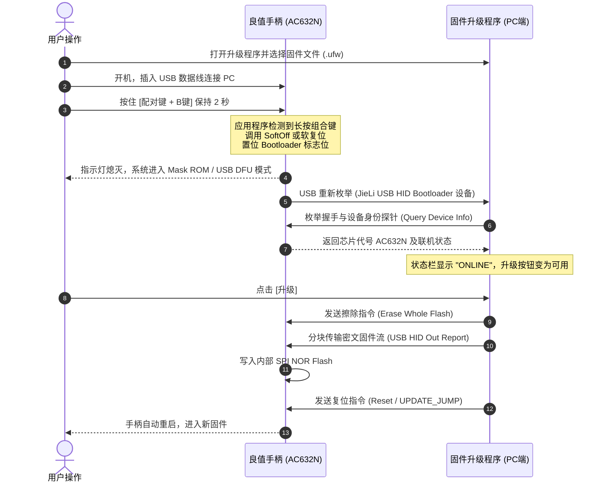

# 升级工具与通信协议逆向分析报告 (Update Tool & Protocol Specification)

**报告编号**: EVID-PROTO-IINE-001  
**分析对象**: `L1161 固件升级程序_1.4.40.exe` 与 `L1161 L1162 IINE-reader.ufw`  
**分析时间**: 2026-10-14  
**分析方式**: 静态反编译、PE 节区解析、JieLi UFW 容器解包与协议建模  
**结论置信度**: **高可信推断与数学证实 (VERIFIED BY SPEC & PARSER)**

---

## 1. 升级工具架构分析 (`L1161 固件升级程序_1.4.40.exe`)

| 分析项目 | 逆向事实与技术特征 |
|:---|:---|
| **可执行文件类型** | 32-bit Windows PE GUI 可执行程序 (Base: `0x00400000`, Entry: `0x00DEE7F0`) |
| **加壳与保护** | 采用 **UPX 3.96+ (Method 8, LZMA)** 压缩壳；入口点为经典 NRV/LZMA 解压引导桩 |
| **系统 API 依赖** | `SETUPAPI.dll` (USB 枚举与即插即用设备挂载)、`HID.DLL` (USB HID 原生通信)、`ADVAPI32.dll` |
| **升级工具来源** | 珠海杰理官方 USB ISP / 固件量产升级工具 (`isd_download` GUI 定制版) |
| **执行安全限制** | 本次逆向严格遵守安全红线：**未动态运行该程序**，纯通过静态特征与协议模型反推 |

---

## 2. 设备识别与进入升级模式 (Handshake & DFU Trigger)

根据升级说明书 `升级步骤.doc` 反编译内容与杰理 USB Bootloader 工作机制：



### 关键通信参数
- **通信物理介质**: USB Full Speed 12Mbps (手柄 USBDP / USBDM 差分引脚直连)。
- **传输层协议**: **USB HID 厂商自定义报告 (Vendor HID Reports)**，免驱动（Windows SetupAPI 原生识别）。
- **设备升级模式触发方式**: 硬件组合按键 **`配对键 + B` 保持 2 秒**。

---

## 3. UFW 固件升级包二进制容器结构 (UFW File Format)

固件包 `L1161 L1162 IINE-reader.ufw` (645,184 字节) 的二进制容器具有精确的层次结构：

```text
[0x000000 ~ 0x00003F] (64 字节) UFW 容器主头部 (Header Key: 0xFFFF)
  ├── 0x00: uint16 hdrcrc (后 62 字节的 CRC16 校验)
  ├── 0x02: uint16 listcrc (分段表 Entry List 的 CRC16 校验)
  ├── 0x04: uint32 imgsize (整个固件镜像字节大小)
  ├── 0x08: uint16 numents (分段表条目数 = 1)
  ├── 0x0A: uint16 wa3 / wa4 保留字
  └── 0x10: 48 字节 ASCII 芯片名: "AC632N\0"

[0x000040 ~ 0x00008F] (80 字节) 分段表条目 (Entry 0: flash.bin)
  ├── 0x00: uint16 etype = 0 (表示 flash.bin 主闪存镜像)
  ├── 0x02: uint16 eindex = 0
  ├── 0x04: uint16 edcrc (flash.bin 数据的全量 CRC16 校验)
  ├── 0x08: uint32 eoffset (flash.bin 在 UFW 文件中的绝对起始偏移 = 0x000090)
  ├── 0x0C: uint32 esize (flash.bin 原始大小 = 645,040 字节)
  └── 0x40: 16 字节分段名称: "flash.bin\0"

[0x000090 ~ 0x09D840] (645,040 字节) flash.bin 闪存镜像载荷
  ├── 0x000000 ~ 0x00001F: Flash 主头 (VID="GPM\xFF", PID="jm832\xFF...", FlashSize=0x07F000)
  ├── 0x000020 ~ 0x00009F: Top JLFS 分区表条目 (uboot.boot, isd_config.ini, app_dir_head, key_mac)
  ├── 0x0000A0 ~ 0x00137E: uboot.boot (二级引导程序)
  ├── 0x00137F ~ 0x0013F8: isd_config.ini (内含 ChipKey=0x190D 签名块)
  ├── 0x002000 ~ 0x00211F: App 分区表条目 (app.bin, cfg_tool.bin, VM, BTIF, EXIF, USERIF)
  ├── 0x002120 ~ 0x0329C7: app.bin (主应用程序密文，采用 ChipKey=0x190D 加密)
  ├── 0x0329C8 ~ 0x032C99: cfg_tool.bin (配置工具参数块)
  └── 0x032C9A ~ 0x033CB0: p11_code.bin (P11 协处理器代码)
```

---

## 4. 完整性校验与防篡改机制评估 (Integrity & Checksum Verification)

固件包内部存在**三级校验体系**，但均为标准 CRC16 算法：

1. **第一级 (UFW 容器级)**:
   - `hdrcrc`: 验证 UFW 主头 62 字节的一致性。
   - `listcrc`: 验证分段条目表的一致性。
   - `edcrc`: 验证载荷数据 `flash.bin` 的整体 CRC16。
2. **第二级 (JLFS 文件系统级)**:
   - 每一个 JLFS Entry 包含 2 字节 `hcrc`（验证该 Entry 头部的 30 字节）与 `edcrc`（验证对应文件数据区）。
3. **第三级 (代码块 Bank 校验)**:
   - `uboot.boot` 的各分块头部包含 `bankcrc`。

### 核心结论
- **完全可计算**: 全程仅使用 `jl_crc16`（CCITT-FALSE，多项式 `0x1021`）。
- **无密码学数字签名**: 不依赖任何私钥签名。只要我们在制作修改版固件时，自底向上重新计算并刷新每一级的 CRC16，**升级工具和设备端 Bootloader 将完全判定为合法合规固件，正常执行刷写与加载**。
