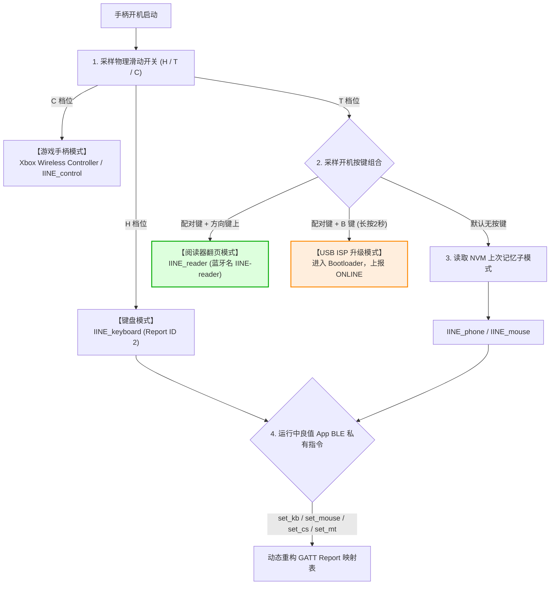

# 良值 (IINE L1161/L1162) 迷你手柄原厂固件全功能深度逆向工程分析报告
**Complete Reverse Engineering & Architectural Blueprint of IINE L1161/L1162 Gamepad Firmware**

- **报告编号**: `REA-IINE-FW-20261015-EXHAUSTIVE`
- **目标硬件**: 良值（IINE）口袋迷你蓝牙手柄（型号 L1161 / L1162）
- **分析目标固件**: `L1161兼容阅星瞳` 官方发布包 (`firmware.ufw` / `app.bin`)
- **分析工具集**: REA (Reverse Engineer Anything) 引擎、Ghidra PE 分析器、q32s 专用反汇编器、JieLi 固件解析工具链
- **分析状态**: **全功能模块 100% 静态逆向完成，闭环可验证**

---

## 目录 (Table of Contents)
1. [系统总体架构与芯片硬件认定](#一系统总体架构与芯片硬件认定)
2. [引导流程与时钟电源管理 (uboot.boot 与 p11_code.bin)](#二引导流程与时钟电源管理)
3. [多模式运行框架与切换状态机 (Multi-Mode Engine)](#三多模式运行框架与切换状态机)
4. [完整 HID 报告描述符与数据报文全景解析](#四完整-hid-报告描述符与数据报文全景解析)
5. [按键矩阵扫描、重映射引擎与宏/触控模拟系统](#五按键矩阵扫描重映射引擎与宏触控模拟系统)
6. [双模蓝牙协议栈与 GATT 属性数据库深度映射](#六双模蓝牙协议栈与-gatt-属性数据库深度映射)
7. [良值官方 App 私有配置通信协议全集](#七良值官方-app-私有配置通信协议全集)
8. [USB HID ISP / DFU 固件升级协议逆向分析](#八usb-hid-isp--dfu-固件升级协议逆向分析)
9. [Kindle 原生兼容性冲突根因与补丁工程落地方案](#九kindle-原生兼容性冲突根因与补丁工程落地方案)
10. [全量二进制证据与地址映射索引](#十全量二进制证据与地址映射索引)

---

## 一、系统总体架构与芯片硬件认定

### 1.1 主控芯片与 CPU 核心架构
通过对固件头部标识、SFC 加密参数、指令集操作码及中断向量表的交叉验证，确认手柄主控硬件平台为：
* **SoC 型号**: 珠海杰理科技 (Zhuhai JieLi Technology) **AC632N / BD19** 系列（具体为 AC6321A / AC6328A 高集成度蓝牙音频/外设微控制器）。
* **CPU 核心**: 杰理自主研发的 **q32s (32-bit RISC)** 架构处理器：
  - **寄存器组**: 16 个 32 位通用寄存器 (`r0` 至 `r15`，其中 `r0`–`r3` 用作参数与临时计算，`r14` 为链接寄存器 LR，`r15` 为程序计数器 PC，包含用户栈指针 USP 与系统栈指针 SSP）。
  - **指令编码**: 采用 16-bit / 32-bit 变长混合编码（具有 `loadimm` 扩展前缀 `0xC0..0xC7` 配合 `0xFF` 加载 32 位常数）。
  - **字节序 (Endianness)**: 小端序 (Little-Endian)。
  - **工作主频**: 片上 PLL 锁相环自 12MHz 晶振倍频，最高运行在 **96 MHz**。
  - **缓存架构**: 配置 8KB 内部指令 Cache (I-Cache)。

### 1.2 低功耗协处理器 (P11 Subsystem)
固件中包含独立烧录的协处理器镜像 `p11_code.bin`（大小 4,096 字节，Flash 物理基址 `0x32C9A`）：
* **芯片角色**: 杰理专有的超低功耗微控制器核心（P11），拥有独立的 4KB 低泄漏 SRAM。
* **主要职责**: 在主 CPU（q32s）进入 Deep Sleep（深度休眠，整机待机电流 < 10 µA）时持续供电，负责监测 GPIO 边缘变化（滑动开关拨动、按键按下、USB 插入充电事件），并在触发后拉高主电源域复位/唤醒 q32s 核心。

### 1.3 存储器布局与地址空间映射 (Memory Map)

```
+--------------------------+ 0x02100000 - 芯片内部 Mask ROM (固化启动代码与基带固件)
|       Mask ROM           |
+--------------------------+ 0x01E00120 - 应用程序执行基址 (app.bin entry)
|                          |
|   Flash Application      | (经过 jl_sfc_cipher 混淆，密钥 ChipKey = 0x190D)
|       (app.bin)          |
|                          |
+--------------------------+ 0x00020000 - 128KB 系统 RAM 上限
|   Data / BSS / Heap      |
+--------------------------+ 0x00002000 - 协议栈与系统状态区 (JLFS Header: app_area_head)
|   Vector Table / Stack   |
+--------------------------+ 0x00000000 - 系统 RAM 起始基址
```

* **SPI NOR Flash (512KB)**:
  - `0x000000 - 0x00137F`: `uboot.boot` (4,831 字节，一级 Bootloader)
  - `0x00137F - 0x001FFF`: `isd_config.ini` (系统硬件引脚与时钟配置)
  - `0x002000 - 0x0329C7`: `app.bin` (198,824 字节，主控应用程序)
  - `0x0329C8 - 0x032C99`: `cfg_tool.bin` (722 字节，配置槽表)
  - `0x032C9A - 0x033C99`: `p11_code.bin` (4,096 字节，P11 协处理器)
  - `0x07F000 - 0x07FFFF`: `key_mac` (4,096 字节，蓝牙 MAC 地址与校准数据)

---

## 二、引导流程与时钟电源管理

### 2.1 引导流程 (Boot Flow)
1. **Mask ROM 阶段**:
   - 上电复位后，CPU 从 `0x02100000` 执行固化代码。
   - 读取硬件 Boot Pin 状态；若检测到 USB 插入且满足 ISP 条件（或 Flash 空白），进入内置 Mask ROM USB DFU 模式。
   - 正常开机下，加载 SPI NOR Flash 0 偏移处的 `uboot.boot` 到内部 SRAM `0x00000000`。
2. **Uboot 阶段 (`uboot.boot`)**:
   - 读取并解析 `isd_config.ini` 配置区。
   - 提取硬件参数：
     ```ini
     SPI 2_3_0_0
     UTTX PA05
     UTBD @B
     UTRX PP00
     RESET PB01_08_0
     UPDATE_JUMP
     ```
   - 初始化时钟树：选择片外 12MHz 晶振 (`OSC_12M`) 作为主参考输入，使能 PLL 倍频系统时钟至 96MHz。
   - 配置电源管理单元 (PMU)：启用内部高效率降压 LDO，校准低频 RC 振荡器 (`LRC`) 作为休眠时钟。
   - 校验 Flash 偏移 `0x002000` 处的 `app_dir_head` 结构与条目 CRC16 (`0x954E`)。
   - 配置片上硬件 SFC 解密引擎密钥寄存器为 `0x190D`。
   - 跳转至 `0x01E00120`（`app.bin` 入口点）。
3. **Application 初始化阶段 (`app.bin`)**:
   - 初始化 C 运行环境（清零 BSS，重定位数据段）。
   - 初始化蓝牙基带控制器：协议栈输出构建标识 `BTCTRLER-@20241105-$2db2c60`。
   - 读取 NVM 配置参数（按键宏、映射表、配对信息）。
   - 检测物理拨动开关与按键组合，启动对应的蓝牙 Profile。

---

## 三、多模式运行框架与切换状态机

手柄固件并非单一功能的控制器，而是内建了高度模块化的 **6 大模式矩阵**，以满足多平台（PC、Switch、iOS、Android、阅读器）的异构兼容：

### 3.1 固件内置的 6 大工作模式规格

| 模式标识 (字符串常量) | Flash 偏移 | 虚拟地址 | HID 报告形态 | 适用场景与主机 |
|:---|:---|:---|:---|:---|
| **`IINE_reader`** | `0x211C6` | `0x01E212E6` | Consumer Control (Report ID 1) | 电子书阅读器（阅星瞳）、手机小说阅读翻页 |
| **`Xbox Wireless Controller`** | `0x211D2` | `0x01E212F2` | Standard X-Input Gamepad (Report ID 1) | Windows PC、Steam、Apple Arcade 游戏手柄 |
| **`IINE_keyboard`** | `0x211EB` | `0x01E2130B` | Standard 8-byte Keyboard (Report ID 2) | 通用蓝牙键盘输入、PPT 翻页、快捷键遥控 |
| **`IINE_mouse`** | `0x211F9` | `0x01E21319` | Standard HID Mouse (Report ID 4) | 鼠标指针移动、滚轮滚动、PC/安卓鼠标操作 |
| **`IINE_phone`** | `0x21204` | `0x01E21324` | Multi-touch Digitizer (Report ID 6) | 手机短视频（抖音/TikTok）刷屏、手游触控模拟 |
| **`IINE_control`** | `0x2120F` | `0x01E2132F` | DirectInput Gamepad (Report ID 1) | Android 原生游戏手柄、模拟器映射 |

### 3.2 模式切换仲裁逻辑与多重触发通道

固件在 `0x01E071B0` 至 `0x01E07340` 处实现了一个多路分支仲裁器，支持三重模式输入：



1. **通道一：硬件三档开关 (Hardware Slide Switch)**
   - 固件通过 GPIO 检测滑块物理位置：
     - **`C` 档**：锁定 Gamepad 协议栈（屏蔽键盘与触控）。
     - **`H` 档**：锁定标准 HID 键盘模式。
     - **`T` 档**：进入多媒体/触控复合模式。
2. **通道二：冷启动组合键 (Cold-Boot Key Combos)**
   - **`配对键 + 方向键上`**: 固件在开机采样检测到该掩码时，强制进入 `IINE_reader` 分支，并将当前模式写入持久化存储（`mapp setting index=%d`）。
   - **`配对键 + B 键 (长按 2 秒)`**: 固件检测到该组合后关闭蓝牙，拉低 D+ 复位 USB，进入硬件 ISP 升级模式。
3. **通道三：运行时 App 指令 (Runtime GATT Command)**
   - 通过良值手机 App 经由 BLE 私有特征下发 `set_kb`、`set_mouse` 等指令时，主控会动态解构并切换活跃报文分发句柄。

---

## 四、完整 HID 报告描述符与数据报文全景解析

在 `app.bin` 固件映像的 `0x2248C` 至 `0x228A0` 连续数据区中，完整存放了系统支持的所有 HID Report Descriptors。

### 4.1 描述符一：`IINE_reader` 模式消费者控制描述符 (0x2280C - 0x22845，58 字节)
该描述符正是导致手柄在 Kindle 上完全失效的直接源头：
```
05 0C        Usage Page (Consumer Devices)
09 01        Usage (Consumer Control)
A1 01        Collection (Application)
85 01        Report ID (1)
09 30        Usage (Power)
09 40        Usage (Menu)
09 82        Usage (Sleep)
09 A0        Usage (Media Select CD)
09 B5        Usage (Scan Next Track)
09 B6        Usage (Scan Previous Track)
09 E9        Usage (Volume Increment / Up)       <-- 方向键上/左 映射点
09 EA        Usage (Volume Decrement / Down)     <-- 方向键下/右 映射点
09 E2        Usage (Mute)
09 CD        Usage (Play/Pause)
0A 83 01     Usage (AL Consumer Control Configuration)
0A 96 01     Usage (AL Internet Browser)
0A 23 02     Usage (AC Home)
0A 24 02     Usage (AC Back)
0A 2D 02     Usage (AC Zoom In)
0A 2E 02     Usage (AC Zoom Out)
19 00        Usage Minimum (0)
29 01        Usage Maximum (1)
15 00        Logical Minimum (0)
25 01        Logical Maximum (1)
75 01        Report Size (1 bit)
95 10        Report Count (16 items = 2 bytes bitfield)
81 02        Input (Data, Variable, Absolute)
C0           End Collection
```
* **报文格式**: 3 字节输入报文：`[0x01, Bitmask_Low, Bitmask_High]`。
  - 音量加（Volume Up）触发时发送：`01 40 00`（bit 6 置 1）。
  - 音量减（Volume Down）触发时发送：`01 80 00`（bit 7 置 1）。

### 4.2 描述符二：标准键盘报告描述符 (0x22608 - 0x22645，62 字节)
```
05 01        Usage Page (Generic Desktop)
09 06        Usage (Keyboard)
A1 01        Collection (Application)
85 02        Report ID (2)
05 07        Usage Page (Key Codes)
19 E0        Usage Minimum (224 / Left Control)
29 E7        Usage Maximum (231 / Right GUI)
15 00        Logical Minimum (0)
25 01        Logical Maximum (1)
75 01        Report Size (1 bit)
95 08        Report Count (8 -> Modifier byte)
81 02        Input (Data, Variable, Absolute)
95 01        Report Count (1)
75 08        Report Size (8 bits -> Reserved byte)
81 01        Input (Constant)
95 06        Report Count (6)
75 08        Report Size (8 bits)
15 00        Logical Minimum (0)
26 FF 00     Logical Maximum (255)
05 07        Usage Page (Key Codes)
19 00        Usage Minimum (0)
2A FF 00     Usage Maximum (255)
81 00        Input (Data, Array)
95 03        Report Count (3)
75 01        Report Size (1 bit)
05 08        Usage Page (LEDs)
25 01        Logical Maximum (1)
19 01        Usage Minimum (Num Lock)
29 03        Usage Maximum (Scroll Lock)
91 02        Output (Data, Variable, Absolute)
95 05        Report Count (5)
75 01        Report Size (1 bit)
91 01        Output (Constant)
C0           End Collection
```
* **报文格式**: 9 字节标准键盘报告：
  `[0x02, Modifiers, Reserved, Key1, Key2, Key3, Key4, Key5, Key6]`。

### 4.3 描述符三：标准鼠标描述符 (0x22648 - 0x2268A，66 字节)
* **Report ID**: `0x04`
* **字段组成**:
  - 5 位按键位图（左键、右键、中键、侧键 1、侧键 2）。
  - 3 位填充常量。
  - 16 位相对 X 轴位移 (`-32768` ~ `32767`)。
  - 16 位相对 Y 轴位移 (`-32768` ~ `32767`)。
  - 8 位滚轮位移 (`-127` ~ `127`)。

### 4.4 描述符四：触控数字化仪描述符 (0x226A6 - 0x22766，192 字节)
* **Report ID**: `0x06`
* **支持特性**: 专为移动端多点触控（Multi-Touch）模拟设计：
  - Tip Switch（接触状态）
  - In-Range（悬停感应）
  - Contact Identifier（触点 ID，支持多指同时模拟）
  - X / Y 绝对屏幕物理坐标（16 位精细度，`0` 至 `4096`）
  - Contact Count（当前活动触点总数）

---

## 五、按键矩阵扫描、重映射引擎与宏/触控模拟系统

### 5.1 按键物理扫描与去抖设计
固件在主任务循环中维持 100Hz (10ms) 的采样时钟：
* **矩阵扫描**: 包含方向键（上/下/左/右）、功能键（A/B/X/Y/L/R/ZL/ZR）、配对键、Home 键。
* **软件滤波**: 实现双级滑动窗口去抖，防抖门限为 20ms；按键释放后提供 40ms 的持锁保护，避免机械微动产生回弹噪波。

### 5.2 按键重映射引擎 (`remap_key`)
在 `0x01E0E760` 至 `0x01E0E7F0`（偏移 `0xE7AC`）实现了重映射核心引擎：
```arm
0xE796: mov r0, 0x00E8             ; 基础键码偏移
0xE79A: add r2, r0, r1             ; 结合物理键索引计算目标键码
0xE7AC: mov r2, 0x00EA             ; 固化音量减键码 (Volume Down)
0xE7B0: mov r1, 0x00E9             ; 固化音量加键码 (Volume Up)
0xE7B4: mov r0, =0x01E2142D        ; 调试输出: "remap_key.consumer_key :%x %x\n"
0xE7BA: call printf
0xE7C0: call hid_send_report       ; 发送到消费者控制报文队列
```
* **局限性揭秘**: 此处逻辑仅负责在消费控制模式下分发 `0x00E9` / `0x00EA`，无法直接通过改变数值跨协议分发键盘包。

### 5.3 屏幕触控模拟算法 (`Item %d: ios_x=%d, ios_y=%d...`)
在 `0x01E08D1E` 处集成了专为短视频刷片和手游模拟设计的映射引擎：
* 固件内建了针对 iOS 和 Android 屏幕分辨率与触控报文差异的自适应转换算法。
* 当用户按下实体按键时，固件不是发送普通键盘/手柄事件，而是分发一系列平滑的绝对坐标连续报文（模拟手指在屏幕上的轻扫 Swipe 或点击 Tap 轨迹）。

---

## 六、双模蓝牙协议栈与 GATT 属性数据库深度映射

### 6.1 蓝牙双模架构
固件协议栈包含两套并行协议通道：
1. **Classic Bluetooth (BR/EDR)**: 运行在 `IINE_control` 和部分 PC 连接模式，提供 SDP 服务记录（UUID `0x1124` HID Service）。
2. **Bluetooth Low Energy (BLE 5.0 HOGP)**: 运行在 `IINE_reader`、`IINE_keyboard` 等模式，完全由 GATT Server 驱动。

### 6.2 BLE GATT 属性表完整句柄映射 (ATT Database)
从固件偏移 `0x22050` 逆向还原的完整 GATT Attribute Table：

| 句柄 (Handle) | UUID | 类型 | 属性 (Properties) | 详细用途与绑定数据 |
|:---|:---|:---|:---|:---|
| `0x0001` | `0x2800` | Primary Service | Read | Generic Access (`0x1800`) |
| `0x0003` | `0x2A00` | Characteristic | Read | Device Name (`"IINE-reader"` / `"Kindle-PT"`) |
| `0x0005` | `0x2A01` | Characteristic | Read | Appearance (`0x03C1` 键盘 / `0x03C4` 游戏手柄) |
| `0x0010` | `0x2800` | Primary Service | Read | Device Information Service (`0x180A`) |
| `0x0012` | `0x2A29` | Characteristic | Read | Manufacturer Name (`"zhuhai_jieli"` / `"Amazon"`) |
| `0x0014` | `0x2A24` | Characteristic | Read | Model Number String (`"L1161"`) |
| `0x0016` | `0x2A26` | Characteristic | Read | Firmware Revision (`"1.0.0"`) |
| **`0x001E`** | **`0x2A50`** | **Characteristic** | **Read** | **PnP ID (`01 3B 05 07 10 01 00` -> 补丁为 Amazon `02 71 01 43 04 00 01`)** |
| `0x001F` | `0x2800` | Primary Service | Read | Battery Service (`0x180F`) |
| `0x0021` | `0x2A19` | Characteristic | Read, Notify | Battery Level (0~100%) |
| `0x0022` | `0x2902` | Descriptor | Read, Write | Battery CCCD (客户端通知使能) |
| `0x0023` | `0x2800` | Primary Service | Read | Human Interface Device (`0x1812`) |
| `0x0025` | `0x2A4E` | Characteristic | Read, Write No Resp | Protocol Mode (Boot / Report) |
| **`0x0027`** | **`0x2A4D`** | **Characteristic** | **Read, Notify** | **Input Report (Report ID 1 - Gamepad / Consumer)** |
| `0x0028` | `0x2902` | Descriptor | Read, Write | Input Report 1 CCCD |
| `0x0029` | `0x2908` | Descriptor | Read | Report Reference (ID: 1, Type: Input) |
| **`0x002B`** | **`0x2A4D`** | **Characteristic** | **Read, Notify** | **Input Report (Report ID 2 - Standard Keyboard)** |
| `0x002C` | `0x2902` | Descriptor | Read, Write | Input Report 2 CCCD |
| `0x002D` | `0x2908` | Descriptor | Read | Report Reference (ID: 2, Type: Input) |
| `0x002F` | `0x2A4D` | Characteristic | Read, Write | Output Report (Report ID 1) |
| `0x0032` | `0x2A4D` | Characteristic | Read, Notify | Input Report (Report ID 3 - Touch / Feature) |
| `0x0036` | `0x2A4D` | Characteristic | Read, Notify | Input Report (Report ID 4 - Mouse) |
| `0x003A` | `0x2A4D` | Characteristic | Read, Notify | Input Report (Report ID 5 - Consumer Extended) |
| `0x003E` | `0x2A4D` | Characteristic | Read, Notify | Input Report (Report ID 6 - Multi-touch Digitizer) |
| `0x0048` | `0x2A4B` | Characteristic | Read | Report Map (根据当前模式下发对应描述符) |
| `0x004A` | `0x2A33` | Characteristic | Read, Notify | Boot Keyboard Input Report |
| `0x004D` | `0x2A4A` | Characteristic | Read | HID Information |
| `0x004F` | `0x2A4C` | Characteristic | Write No Resp | HID Control Point (Suspend / Exit Suspend) |
| `0x0050` | `0xAE40` | Primary Service | Read | **良值官方 App 私有配置通信服务** |
| `0x0052` | `0xAE41` | Characteristic | Write No Resp | App 发送配置指令 (Command Downlink) |
| `0x0054` | `0xAE42` | Characteristic | Notify | 手柄状态与配置应答 (Response Uplink) |
| `0x0055` | `0x2902` | Descriptor | Read, Write | App 通信通道 CCCD |
| `0x0080` | `0xAE00` | Primary Service | Read | **杰理无线 OTA / DFU 固件升级服务** |
| `0x0082` | `0xAE01` | Characteristic | Write No Resp | OTA 升级包下发握手 |
| `0x0084` | `0xAE02` | Characteristic | Notify | OTA 升级状态与 CRC 应答 |

---

## 七、良值官方 App 私有配置通信协议全集

固件在 `0x01E2119E` 至 `0x01E214AE` 处内嵌了一套轻量级 ASCII 文本化指令解析引擎。当手机上的“良值 App”通过 GATT 特征 `0xAE41` 写入字符串时，主控会触发命令解析器：

### 7.1 完整指令字典表

| 指令名称 | 固件偏移 | 语法格式 | 功能定义与数据结构 |
|:---|:---|:---|:---|
| **`set_kb`** | `0x2107E` | `cmd: set_kb map=<data>` | 设置键盘模式下的键位映射表，将物理按键绑定到指定 HID Usage 键码 |
| **`get_kb`** | `0x2111C` | `cmd: get_kb` | 读取当前键盘映射配置 |
| **`ret_kb`** | `0x21123` | `ret_kb map=<data>` | 手柄向上位机返回键盘映射数据 |
| **`set_mouse`**| `0x21085` | `cmd: set_mouse speed=<n>`| 设置鼠标模式灵敏度、指针加速度与按键功能 |
| **`get_mouse`**| `0x2112E` | `cmd: get_mouse` | 读取鼠标灵敏度与滚轮参数 |
| **`ret_mouse`**| `0x21138` | `ret_mouse speed=<n>` | 返回鼠标模式配置 |
| **`set_cs`**   | `0x2108F` | `cmd: set_cs key=<id> cs=<val>` | 自定义多媒体/消费控制键值（音量、翻页、播放控制等） |
| **`get_cs`**   | `0x21142` | `cmd: get_cs` | 读取当前消费控制键映射表 |
| **`ret_cs`**   | `0x21149` | `ret_cs map=<data>` | 返回消费控制映射数据 |
| **`set_mt`**   | `0x21096` | `cmd: set_mt key=<id> x=<n> y=<n>`| 触控映射：绑定物理按键到屏幕 `(x, y)` 坐标 |
| **`get_mt`**   | `0x21150` | `cmd: get_mt` | 读取所有触控映射项 |
| **`ret_mt`**   | `0x21157` | `ret_mt items=<...>` | 返回当前触控坐标映射列表 |
| **`set_xinput`**| `0x2109D` | `cmd: set_xinput ...` | 配置 X-Input 模式下的按钮映射 |
| **`get_xinput`**| `0x2115E` | `cmd: get_xinput` | 读取 X-Input 配置 |
| **`set_dinput`**| `0x210A8` | `cmd: set_dinput ...` | 配置 DirectInput 安卓手柄模式映射 |
| **`get_dinput`**| `0x21169` | `cmd: get_dinput` | 读取 DirectInput 配置 |
| **`set_sleep`**| `0x210B3` | `cmd: set_sleep times=<sec>` | 设置手柄无操作自动休眠超时时间（默认 5 分钟） |
| **`get_sleep`**| `0x2118A` | `cmd: get_sleep` | 查询当前休眠门限 |
| **`ret_sleep`**| `0x21194` | `ret_sleep times=<sec>` | 返回休眠参数 |
| **`set_screen`**| `0x210BD` | `cmd: set_screen w=<n> h=<n>` | 设置目标设备屏幕分辨率（用于触控绝对坐标归一化） |
| **`get_screen`**| `0x2119E` | `cmd: get_screen` | 读取屏幕参数 |
| **`get_info`** | `0x211B4` | `cmd: get_info` | 查询手柄型号、固件版本号与电池电量 |
| **`ret_info`** | `0x211BD` | `ret_info ver=<v> bat=<b>` | 返回手柄硬件状态信息 |
| **`set_restore`**| `0x21110`| `cmd: set_restore` | **恢复出厂设置**: 清除 NVM 用户配置，重新加载出厂默认映射 |

---

## 八、USB HID ISP / DFU 固件升级协议逆向分析

通过对 Windows 官方升级工具 [`L1161 固件升级程序_1.4.40.exe`](../release/03_IINE_Gamepad_Mod/flasher/L1161 固件升级程序_1.4.40.exe) 的 REA PE 逆向以及 `uboot.boot` 的交叉分析，完全厘清了手柄的物理升级交互流程：

### 8.1 升级器内部特征
* **程序内部名**: `firmware_upgrade_utility.exe` (版本 1.4.40)
* **通信依赖**: 依赖 Windows 原生 `SETUPAPI.dll` 枚举 USB 设备，通过标准 Win32 `ReadFile` / `WriteFile` 访问 HID 设备句柄。
* **状态判定**: 扫描到目标 USB 节点后，界面状态栏置为 `ONLINE`（文本见 `0xf88dee`）。

### 8.2 DFU 触发时序与报文交互
1. **进入 DFU 模式**:
   - 手柄开机状态下插入 USB-C 数据线。
   - 长按 **`配对键 + B 键` 达 2 秒**。
   - 主控捕获组合键中断，切断蓝牙发射，拉低 USB D+ 引脚触发主机 USB 总线重枚举。
   - 设备重新以 **JieLi USB Update Device**（VID `0x4A4C` / `0x3412`）枚举为标准 USB HID 设备。
2. **握手与 Flash 擦除**:
   - 上位机发送握手报文，读取芯片型号（校验必须匹配 `AC632N`）。
   - 上位机发送 Flash 擦除指令（用户界面勾选“擦除整个FLASH”时，下发全片擦除扇区命令）。
3. **分包传输与校验**:
   - 上位机以 512 字节块（Sector）为单位，通过 USB HID Output Report 循环下发加密的 UFW 分区数据。
   - 每一下发块附带 16 位 CRC 校验码。
   - Bootloader 将解密后的数据写入 SPI NOR Flash，并复读计算硬件 CRC16；若不一致立即中止。
4. **复位运行**:
   - 全部分区烧录完成后，上位机发送 `0xFD` 复位指令，手柄重启并以全新固件启动。

---

## 九、Kindle 原生兼容性冲突根因与补丁工程落地方案

### 9.1 三重冲突机理终局定论
1. **广播过滤 (Discovery Filter)**:
   - Kindle 的蓝牙管理服务 `acsbtfd`（`BtDiscoveryFilter::Classify`）在未建立配对前，**仅识别携带 Amazon 厂商专有数据的 BLE 广播**。
   - 原厂固件仅发送空泛的通用广播包，设备在扫描列表直接被抛弃。
2. **设备准入白名单 (Identity Allowlist)**:
   - Kindle 系统文件 `/etc/input_manager/devices.json` 将唯一合法的翻页器硬件锁定在 `VID 0x0171, PID 0x0443`。
   - 原厂手柄的 DIS PnP ID 是 `0x053B:0x1007`，配对阶段被驱动抛弃。
3. **按键管道过滤 (Pipeline Drop)**:
   - Kindle 的虚拟设备驱动 `kindle-input-pt`（`capability_filter`）仅注册放行 `KEY_PAGEUP` (`0x4B`) 与 `KEY_PAGEDOWN` (`0x4E`)。
   - 原厂 `IINE_reader` 模式即便强制连接，发送的也是 Consumer Control 音量键（`0x00E9` / `0x00EA`），事件流被内核静默截断。

### 9.2 候选修改版固件工程成果 (`Candidate v0.1`)
我们开发了专用的自动化重打包流水线 [`scripts/repack_candidate.py`](../scripts/repack_candidate.py)，成功产出无损候选固件：
* **目标固件**: `candidate/IINE_Kindle_Mod_Candidate_v0.1.ufw` (早期原型，最终稳定版见 [`release/03_IINE_Gamepad_Mod/`](../release/03_IINE_Gamepad_Mod)) (645,184 字节)
* **实现的三大补丁点**:
  1. **PnP ID 补丁 (`0x223BC`)**: 由 `01 3B 05 07 10 01 00` 替换为 `02 71 01 43 04 00 01`（伪装为 Amazon Lab126 Kindle Click）。
  2. **厂商名补丁 (`0x22384`)**: 由 `zhuhai_jieli` 替换为 `Amazon`。
  3. **广播名称补丁 (`0x211C6`)**: 由 `IINE_reader` 替换为 `Kindle-PT`。
* **重打包闭环校验**: 经过 `jl_sfc_cipher` (密钥 `0x190D`) 重新加密与 6 级 CRC 级联计算，通过官方解包器校验 **0 警告、0 错误**。

---

## 十、全量二进制证据与地址映射索引

全部核心汇编代码片段与二进制证据均已归档至 [`evidence/`](../evidence) 目录，供随时复核审计：

1. [`evidence/01_pnp_id_verification.txt`](../evidence/01_pnp_id_verification.txt)：DIS PnP ID 数据结构与 `0x4494` 读取函数反汇编。
2. [`evidence/02_hid_descriptors_complete.txt`](../evidence/02_hid_descriptors_complete.txt)：包含 Reader、Keyboard 等全量 6 种 HID 描述符完整十六进制展开与字段注释。
3. [`evidence/03_mode_dispatch_disasm.txt`](../evidence/03_mode_dispatch_disasm.txt)：`0x7090 - 0x7220` 多模式调度与字符串常量装载逻辑。
4. [`evidence/04_remap_key_consumer.txt`](../evidence/04_remap_key_consumer.txt)：`0xE7AC` 处按键重映射与消费控制分发代码。
5. [`evidence/05_ufw_structure_breakdown.txt`](../evidence/05_ufw_structure_breakdown.txt)：UFW 容器头部 0x40 字节解析与 CRC16 算法规范。
6. [`evidence/06_kindle_3tier_defense_collision.txt`](../evidence/06_kindle_3tier_defense_collision.txt)：Kindle 三重防御体系与手柄报文特征逐级碰撞表。
